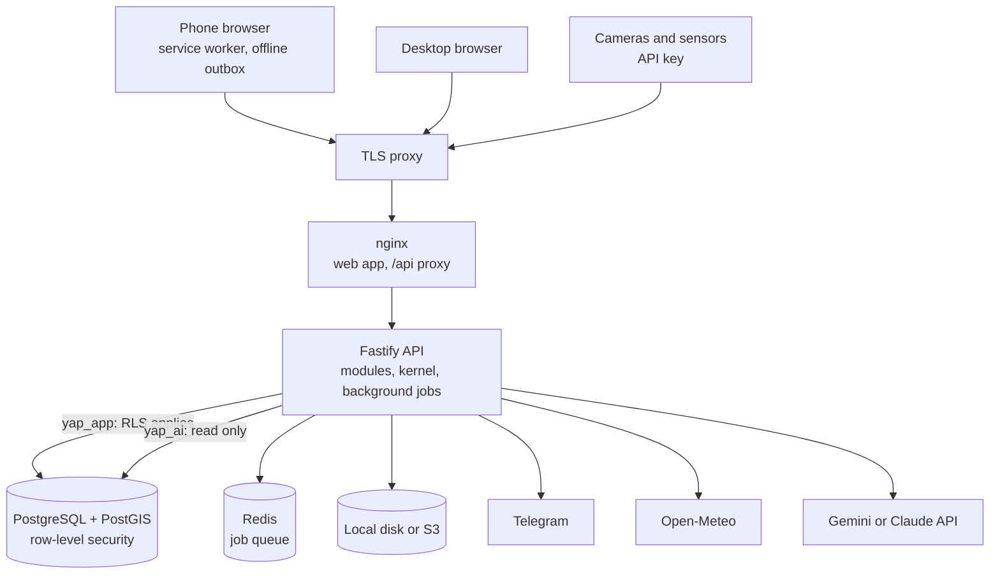
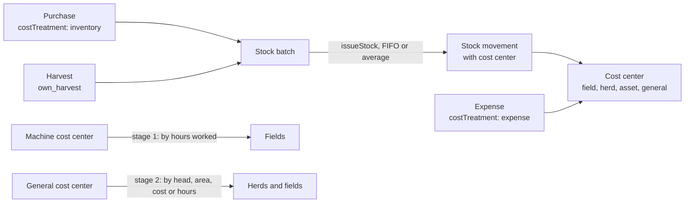

# Architecture

## Components

The code is a pnpm monorepo. `packages/shared` holds what both sides need: formulas, permissions, enums and
translations. Uzbek Cyrillic is generated from Uzbek Latin when dictionaries load, so it has no files of its
own.

## A request

Every route is defined through `routes()` in `apps/api/src/core/http.ts`. In order:

1. Fastify validates the query, body and params against the route's zod schemas. This comes before
   authentication, so a malformed request gets a 400 even without a token.
2. On PATCH, keys the client did not send are dropped. zod keeps `.default()` inside `.partial()`, so otherwise
   an update would silently reset those fields.
3. The caller is identified: a JWT for people, or `X-Api-Key` for machines.
4. `withTenant()` opens one transaction and sets `app.tenant_id`, `app.user_id`, `app.ip` and `app.device`.
5. The membership, role and tenant are loaded on every request, so blocking someone takes effect at once.
6. Permission, tenant module and 2FA policy are checked.
7. A POST with `Idempotency-Key` that was already processed replays the stored response.
8. The handler runs. It reaches the transaction through `tx()` and the caller through `ctx()`.
9. The result is wrapped as `{ data }` and the transaction commits before the response leaves. Any error
   rolls the whole request back.

## Tenancy and isolation

A tenant is one legal entity, and it can have several farms. Isolation is enforced in the database:

- `post-schema.sql` loops over the catalog and gives every table with `tenant_id` a row-level security policy,
  so a new table is covered without anyone remembering.
- The API connects as `yap_app`, which does not own the tables and has no `BYPASSRLS`.
- With no tenant set, queries see nothing.
- Foreign key checks ignore RLS, so every foreign key between tenant tables has a composite `(tenant_id, id)`
  twin. A row cannot point at another tenant's data, whichever code wrote it.
- `withPlatform()` reaches identity tables only (`tenants`, `farms`, `roles`, `memberships`, `api_keys`). A
  platform admin cannot read tenant business data, because the policies do not allow it.

Audit is also generic: a trigger records who changed what, with before and after values. The API role can read
`audit_logs` but cannot write them, and cannot update or delete `events`.

## Permissions

Permissions are `<module>.<action>`, with defaults per role in `packages/shared/src/permissions.ts`. Tenants
can edit them per role.

- Money needs `finance.view`, and the API strips those fields; hiding them in the UI is not enough.
- A module's manager sees that module's costs: `crops.approve` for crop costs, `feed.approve` for feed costs.
- Investors hold `finance.summary`: aggregate figures on the dashboard and investor report, not the books.
- Personal data needs `pii.view`.

## The kernel

`apps/api/src/core` is shared by all modules, and it never imports from them.

| File | Responsibility |
| --- | --- |
| `http.ts` | `routes()`, described above |
| `context.ts` | `ctx()`, `tx()`, `withTenant()`, `withPlatform()` |
| `inventory.ts` | The only code that changes stock |
| `ledger.ts` | The only code that changes money records |
| `costCenters.ts` | Creating and renaming cost centers |
| `journal.ts` | The event journal that reports and AI read |

## How stock and money flow

`transactions.costTreatment` prevents double counting. Feed bought for stock is `inventory`, so it reaches a
cost center only when issued. `capex` reaches cost centers through depreciation, and `animal` is capitalised
into the animal's own cost.

Only `approved` transactions count. At or above the tenant's threshold a transaction stays `pending` until a
different person approves it. An approved entry is voided, never deleted.

A source record such as a daily log stores `refType` and `refId` on its stock movements, so editing it reverses
and re-issues the stock.

The cost engine is `modules/finance/summary.ts`, and reports and the dashboard call it rather than recompute.
Internal transfers of own produce make per-center totals exceed farm-level cash cost by design. Farm-level
figures come from transactions only.

Formulas live in `packages/shared/src/formulas`. A zero denominator gives `null`, shown as a dash, never 0.

## Offline

Field staff work through `/today`. The farm's connection is unreliable, so:

- `apps/web/public/sw.js` keeps the app shell and hashed assets available. It does not cache API responses,
  with one exception: when the network fails, it answers the session refresh from a saved snapshot, so a shepherd
  is not sent to the login screen. The snapshot authorises nothing on the server.
- `GET /today` returns the reference data the forms need, with no money in it. It is kept in IndexedDB.
- `apps/web/src/lib/outbox.ts` queues each record with a client-generated id and an `Idempotency-Key`, and replays
  in order with backoff when the connection returns. A repeat delivery cannot issue feed twice.
- When the server already has a different record for the same herd and day, the record moves to a conflict list
  for a person to decide. Records are never silently lost.

## Background jobs

BullMQ schedules jobs in Redis, and the worker runs inside the API process. A `FarmJob` runs once per active
farm with a system identity, and one farm failing does not stop the others. Times are Asia/Tashkent.

| Job | Schedule |
| --- | --- |
| `notifications.dispatch`, `webhooks.dispatch` | Every minute |
| `alerts.repeat-urgent`, `devices.offline-check` | Every 5 minutes |
| `alerts.evaluate` | Hourly |
| `farm.weather` | Every 6 hours |
| `tasks.generate-recurring` | 00:05 daily |
| `ai-statistics` | 05:15 daily |
| `notifications.daily-summary` | 07:00 daily |
| `ai-summary-weekly` | Monday 08:00 |
| `ai-summary-monthly` | 1st of the month, 08:30 |
| `assets.monthly-depreciation`, `reports.scheduled-delivery`, `reports.investor-monthly` | See the module's `jobs.ts` |

## AI

AI lives in `modules/ai` and reads through the `yap_ai` role, which Postgres limits to read access plus
`ai_insights`, `ai_conversations` and `ai_messages`. It cannot change business data, and it cannot read
password hashes. Statistical insights need no LLM. The assistant works through predefined read-only tools,
filtered by the caller's permissions.
