# Data model

Generated from `apps/api/src/db/schema` by `apps/api/src/db/erd.ts`. Do not edit by hand; run
`pnpm --filter @yap/api exec tsx src/db/erd.ts` after a schema change. 104 tables.

Links to `tenants`, `farms` and `users` (`tenant_id`, `farm_id`, `created_by`) are on almost every
table and are left out of the lines to keep the diagrams readable. A table from another domain appears
as an empty box. Beyond the Drizzle schema, `post-schema.sql` adds PostGIS `geom` columns on `fields`
and `facilities`, row-level security, audit triggers, and a composite `(tenant_id, id)` twin for every
foreign key between tenant tables.

## Platform and identity

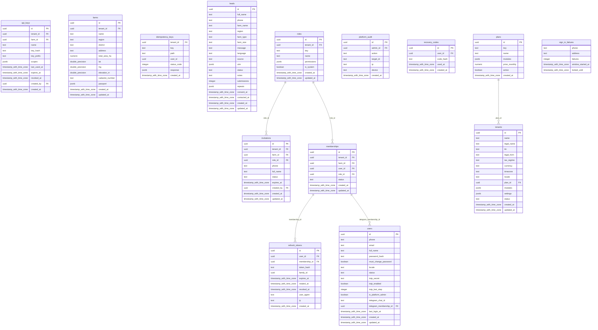

## Core: journal, audit, files, reference data

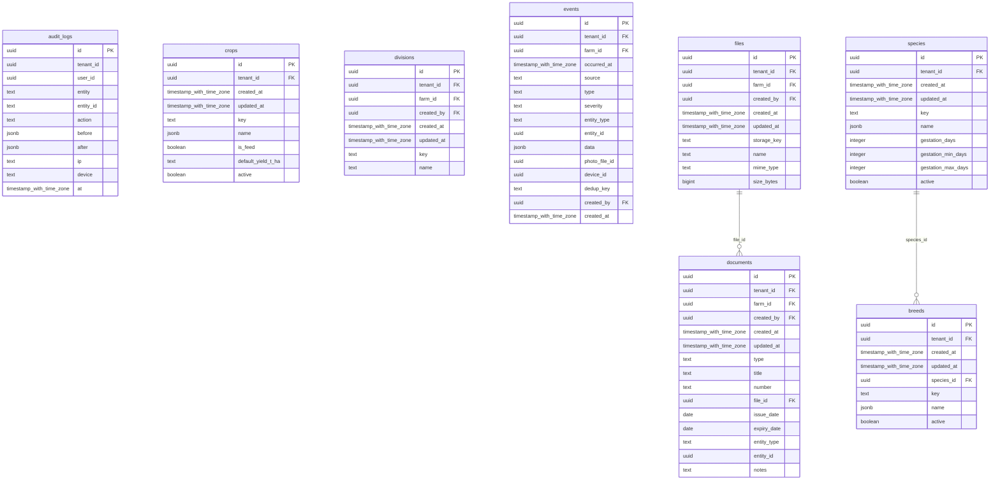

## Land and crops

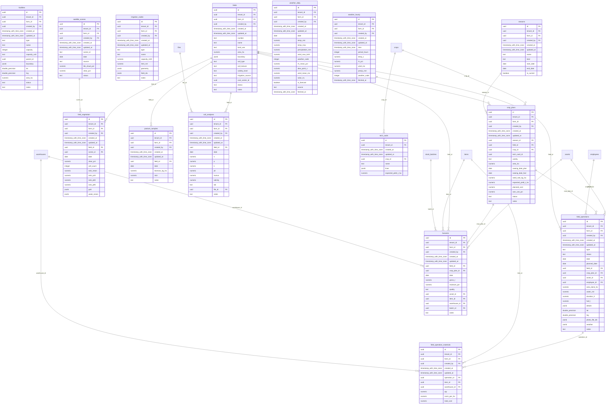

## Livestock and veterinary

```mermaid
erDiagram
  animal_exits {
    uuid id PK
    uuid tenant_id FK
    uuid farm_id FK
    uuid created_by FK
    timestamp_with_time_zone created_at
    timestamp_with_time_zone updated_at
    uuid animal_id FK
    text type
    date date
    numeric live_weight_kg
    numeric carcass_weight_kg
    numeric price_per_kg
    numeric amount
    uuid counterparty_id FK
    text reason
    text vet_conclusion
    numeric loss_amount
    uuid transaction_id FK
    uuid batch_id FK
    jsonb photo_file_ids
    text notes
  }
  animal_identifiers {
    uuid id PK
    uuid tenant_id FK
    uuid farm_id FK
    uuid created_by FK
    timestamp_with_time_zone created_at
    timestamp_with_time_zone updated_at
    uuid animal_id FK
    text type
    text value
    boolean active
  }
  animals {
    uuid id PK
    uuid tenant_id FK
    uuid farm_id FK
    uuid created_by FK
    timestamp_with_time_zone created_at
    timestamp_with_time_zone updated_at
    text tag
    uuid species_id FK
    uuid breed_id FK
    text sex
    text category
    date birth_date
    boolean birth_date_estimated
    text origin
    uuid dam_id FK
    uuid sire_id FK
    date purchase_date
    numeric purchase_price
    uuid seller_id FK
    uuid herd_id FK
    uuid facility_id FK
    text status
    date quarantine_until
    numeric current_weight_kg
    date last_weighed_on
    numeric birth_weight_kg
    uuid photo_file_id FK
    date exit_date
    text notes
  }
  breeding_records {
    uuid id PK
    uuid tenant_id FK
    uuid farm_id FK
    uuid created_by FK
    timestamp_with_time_zone created_at
    timestamp_with_time_zone updated_at
    uuid ewe_id FK
    uuid ram_id FK
    text source
    date mating_date
    date expected_date
    date expected_earliest
    date expected_latest
    text status
    text notes
  }
  daily_log_lines {
    uuid id PK
    uuid tenant_id FK
    uuid farm_id FK
    uuid created_by FK
    timestamp_with_time_zone created_at
    timestamp_with_time_zone updated_at
    uuid log_id FK
    uuid item_id FK
    uuid warehouse_id FK
    numeric planned_qty
    numeric actual_qty
    numeric total_cost
  }
  daily_logs {
    uuid id PK
    uuid tenant_id FK
    uuid farm_id FK
    uuid created_by FK
    timestamp_with_time_zone created_at
    timestamp_with_time_zone updated_at
    uuid herd_id FK
    date date
    integer head_count
    numeric water_l
    text condition
    jsonb photo_file_ids
    text notes
  }
  health_records {
    uuid id PK
    uuid tenant_id FK
    uuid farm_id FK
    uuid created_by FK
    timestamp_with_time_zone created_at
    timestamp_with_time_zone updated_at
    text type
    uuid animal_id FK
    uuid herd_id FK
    date date
    text diagnosis
    uuid item_id FK
    uuid warehouse_id FK
    numeric dose
    text dose_unit
    numeric qty_used
    integer course_days
    uuid vet_employee_id FK
    text result
    integer withdrawal_days
    date withdrawal_until
    integer head_count
    numeric total_cost
    date next_due_date
    uuid vaccination_plan_id
    text report_status
    date ended_on
    jsonb photo_file_ids
    text notes
  }
  herd_transfers {
    uuid id PK
    uuid tenant_id FK
    uuid farm_id FK
    uuid created_by FK
    timestamp_with_time_zone created_at
    timestamp_with_time_zone updated_at
    uuid animal_id FK
    uuid from_herd_id FK
    uuid to_herd_id FK
    date date
    text reason
  }
  herds {
    uuid id PK
    uuid tenant_id FK
    uuid farm_id FK
    uuid created_by FK
    timestamp_with_time_zone created_at
    timestamp_with_time_zone updated_at
    text name
    text state
    uuid facility_id FK
    uuid ration_id FK
    uuid cost_center_id
    text status
    text notes
  }
  lambing_records {
    uuid id PK
    uuid tenant_id FK
    uuid farm_id FK
    uuid created_by FK
    timestamp_with_time_zone created_at
    timestamp_with_time_zone updated_at
    uuid breeding_id FK
    uuid ewe_id FK
    date date
    integer lambs_born
    integer lambs_alive
    jsonb lambs
    text complications
    text notes
  }
  pasture_moves {
    uuid id PK
    uuid tenant_id FK
    uuid farm_id FK
    uuid created_by FK
    timestamp_with_time_zone created_at
    timestamp_with_time_zone updated_at
    uuid herd_id FK
    uuid field_id FK
    date out_date
    date return_date
    text notes
  }
  shearing_records {
    uuid id PK
    uuid tenant_id FK
    uuid farm_id FK
    uuid created_by FK
    timestamp_with_time_zone created_at
    timestamp_with_time_zone updated_at
    uuid animal_id FK
    uuid herd_id FK
    date date
    numeric wool_kg
    text quality
    uuid batch_id FK
    text notes
  }
  vaccination_plans {
    uuid id PK
    uuid tenant_id FK
    uuid farm_id FK
    uuid created_by FK
    timestamp_with_time_zone created_at
    timestamp_with_time_zone updated_at
    text name
    uuid item_id FK
    uuid species_id FK
    text category
    integer age_days
    integer interval_days
    boolean mandatory
    boolean active
    text notes
  }
  weighing_campaigns {
    uuid id PK
    uuid tenant_id FK
    uuid farm_id FK
    uuid created_by FK
    timestamp_with_time_zone created_at
    timestamp_with_time_zone updated_at
    uuid herd_id FK
    date date
    text name
    text status
  }
  weight_records {
    uuid id PK
    uuid tenant_id FK
    uuid farm_id FK
    uuid created_by FK
    timestamp_with_time_zone created_at
    timestamp_with_time_zone updated_at
    uuid animal_id FK
    date date
    numeric weight_kg
    text method
    uuid campaign_id FK
    text notes
  }
  animals ||--o{ animal_exits : "animal_id"
  animals ||--o{ animal_identifiers : "animal_id"
  animals ||--o{ animals : "dam_id"
  animals ||--o{ animals : "sire_id"
  animals ||--o{ breeding_records : "ewe_id"
  animals ||--o{ breeding_records : "ram_id"
  animals ||--o{ health_records : "animal_id"
  animals ||--o{ herd_transfers : "animal_id"
  animals ||--o{ lambing_records : "ewe_id"
  animals ||--o{ shearing_records : "animal_id"
  animals ||--o{ weight_records : "animal_id"
  breeding_records ||--o{ lambing_records : "breeding_id"
  breeds ||--o{ animals : "breed_id"
  counterparties ||--o{ animal_exits : "counterparty_id"
  counterparties ||--o{ animals : "seller_id"
  daily_logs ||--o{ daily_log_lines : "log_id"
  employees ||--o{ health_records : "vet_employee_id"
  facilities ||--o{ animals : "facility_id"
  facilities ||--o{ herds : "facility_id"
  fields ||--o{ pasture_moves : "field_id"
  files ||--o{ animals : "photo_file_id"
  herds ||--o{ animals : "herd_id"
  herds ||--o{ daily_logs : "herd_id"
  herds ||--o{ health_records : "herd_id"
  herds ||--o{ herd_transfers : "from_herd_id"
  herds ||--o{ herd_transfers : "to_herd_id"
  herds ||--o{ pasture_moves : "herd_id"
  herds ||--o{ shearing_records : "herd_id"
  herds ||--o{ weighing_campaigns : "herd_id"
  items ||--o{ daily_log_lines : "item_id"
  items ||--o{ health_records : "item_id"
  items ||--o{ vaccination_plans : "item_id"
  rations ||--o{ herds : "ration_id"
  species ||--o{ animals : "species_id"
  species ||--o{ vaccination_plans : "species_id"
  stock_batches ||--o{ animal_exits : "batch_id"
  stock_batches ||--o{ shearing_records : "batch_id"
  transactions ||--o{ animal_exits : "transaction_id"
  warehouses ||--o{ daily_log_lines : "warehouse_id"
  warehouses ||--o{ health_records : "warehouse_id"
  weighing_campaigns ||--o{ weight_records : "campaign_id"
```

## Inventory and feed

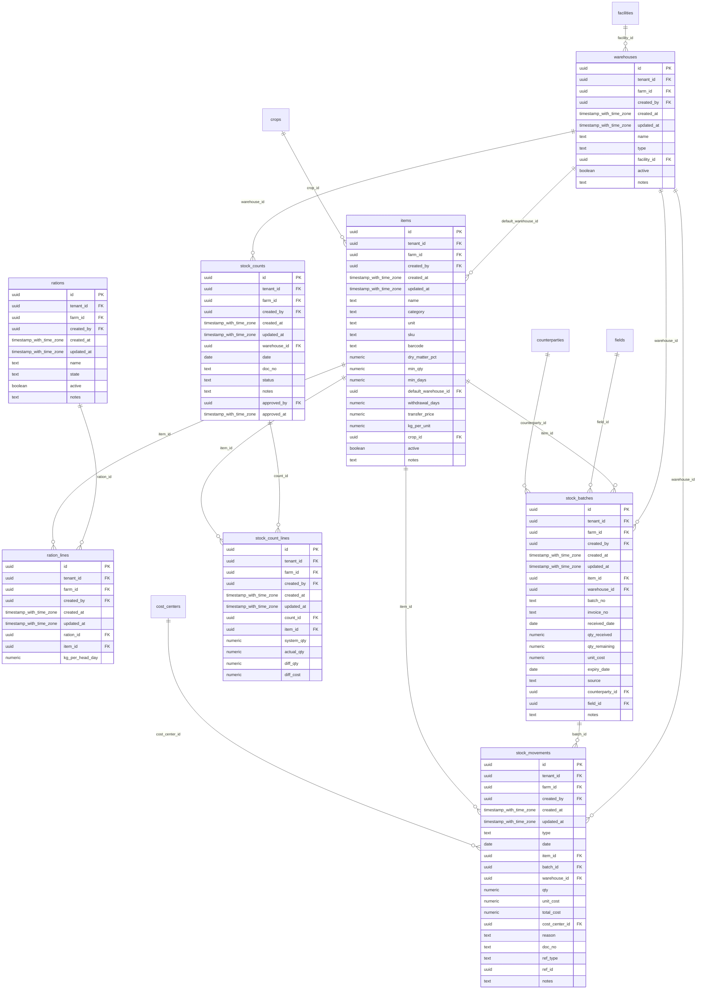

## Finance

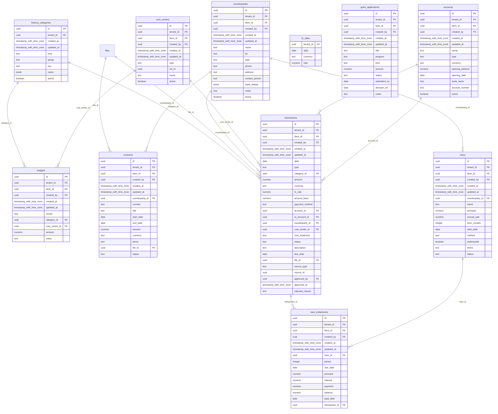

## HR and payroll

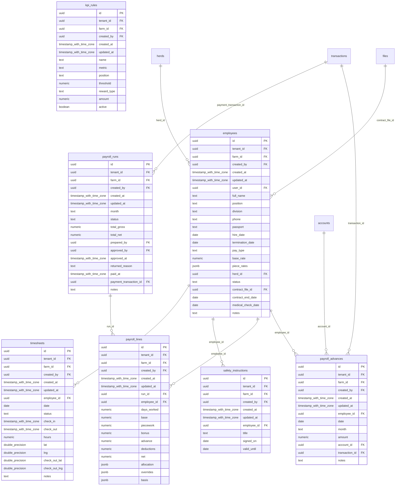

## Machinery

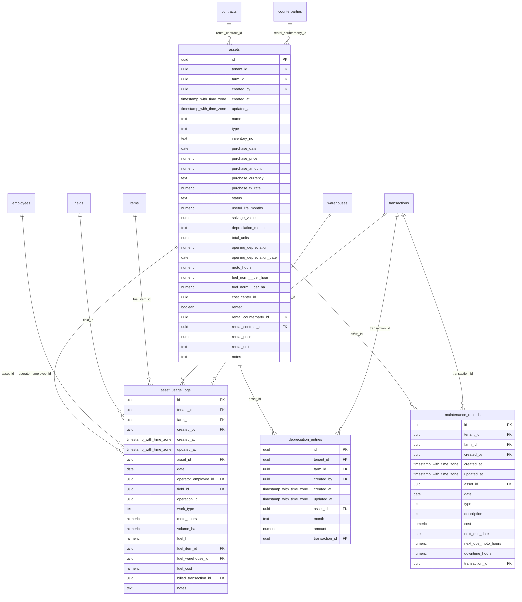

## Sales and purchasing

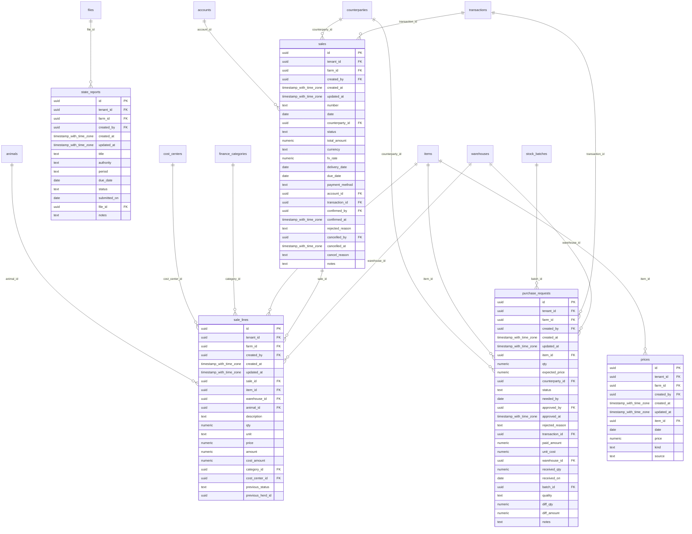

## Tasks, alerts, notifications

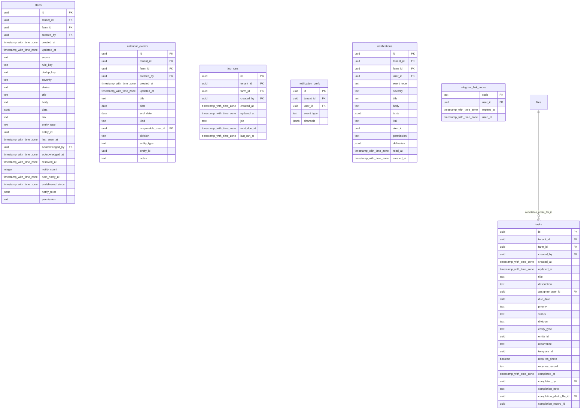

## Devices

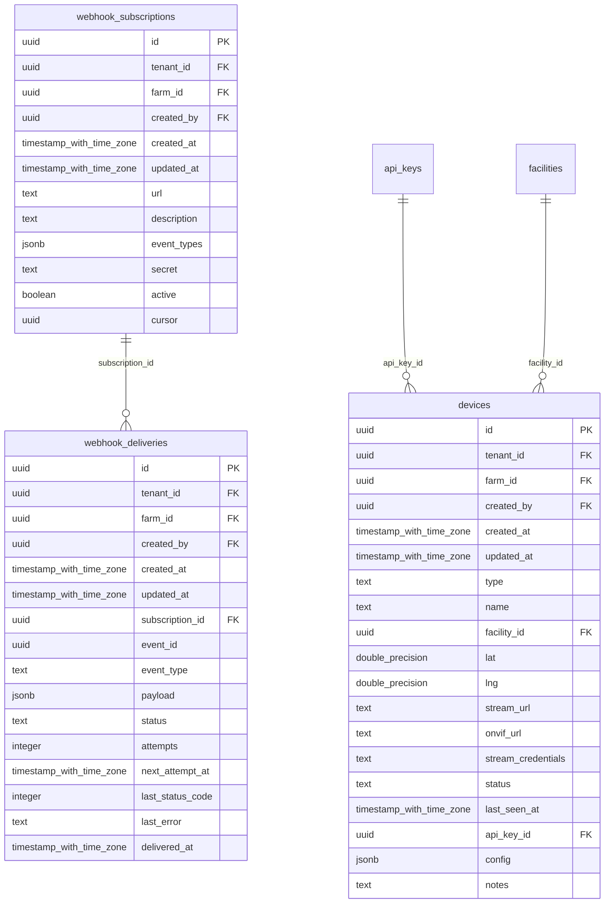

## AI

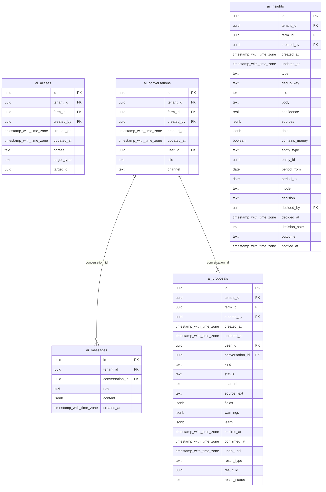

## Reports and import

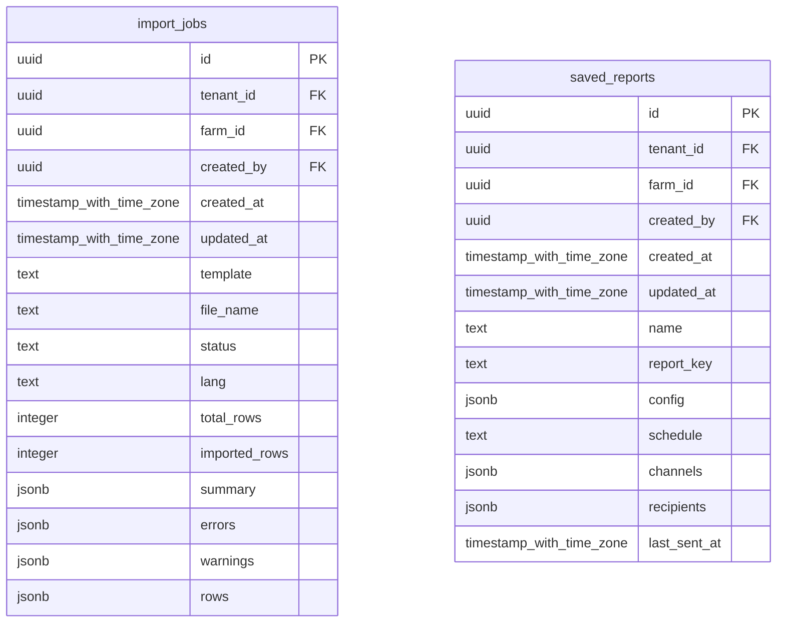
